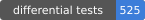
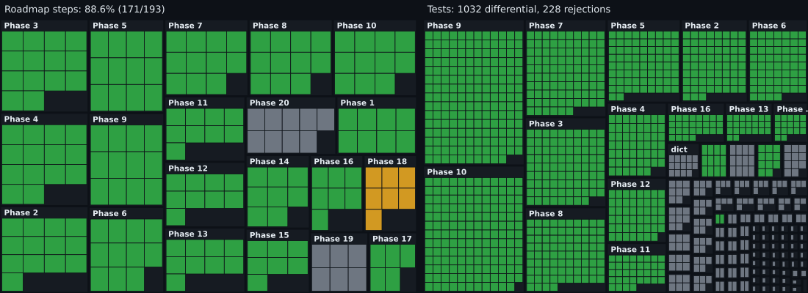

# py2go

Transpiler from Python 3.13 to Go.

## Status

  

A phase is done when its exit test passes (see [decisions](docs/decisions.md)). The pictures are drawn by `go run ./cmd/progress` from the roadmap, the decision log and the test directories; run it after finishing a phase.

## Usage

    py2go file.py        # writes file.go next to it

Generated code imports `github.com/amayakmt/py2go/runtime`, so build it inside a
module that requires py2go (or uses a `replace` directive pointing at a checkout).
Python 3.13 is resolved through `uv`.

## Tests

    go test -count=1 ./...

Each case under `testdata/phase2/` to `phase10/` runs under CPython 3.13 (committed
`expected.txt`) and as transpiled Go; stdout must match. Cases under
`testdata/unsupported/` assert the exact error and line number.
After adding a case, `scripts/regen_expected.sh testdata/phase2/<case>` records
CPython's output. The phase 9 exit test, `TestPhase9Stripped`, runs the cases of
phases 2 to 8 again with every type annotation removed
(`scripts/strip_annotations.py`). The Unicode tables of the runtime are generated
from CPython by `scripts/gen_unicode_tables.py`.

## Source language

Python 3.13 only. Pinned in .python-version.

## Scope

- Standard library only
- `int` has any size in code without annotations; an annotated `int` is 64 bits and
  raises `OverflowError` on `*`, `**` and `<<` beyond that
- Type hints are optional. Annotated code compiles to typed Go and an annotation
  is a contract (a value of the wrong type is a compile error); code without
  annotations runs through the dynamic operations of the runtime
- Unsupported syntax fails with a line number